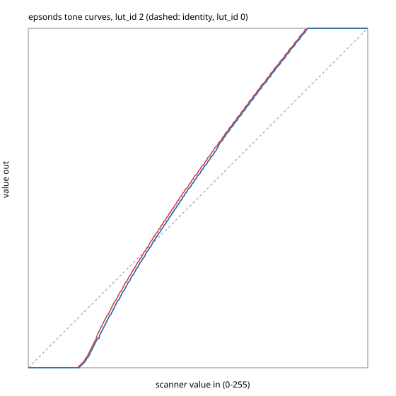

# Colour-calibrating an Epson FastFoto FF-680W on Linux

Findings from calibrating the FastFoto FF-680W photo scanner, driven by SANE's
`epsonds` backend, with a Calibrite ColorChecker Classic Mini. The procedure,
and what is left to do, is in
[`docs/runbooks/scanner-color-profile.md`](../runbooks/scanner-color-profile.md).
This document records what we measured and why the fix took the shape it did.

## Summary

- Scans looked darker, higher-contrast and more saturated than the prints. The
  cause was not the scanner but the driver. sane-backends' `epsonds` files the
  FF-680W with Epson's DS-530 document scanners and uploads that family's tone
  curves on every colour scan. Those curves send scanner values 0–38 to black
  and 210 and up to white. It also applies the DS-530's colour matrix.
- No colour profile can undo that clipping. We tried three profiles on the
  clipped data first; each traded one fault for another.
- A one-line driver change
  ([`_sane-ff680w-native-tone.patch`](../../modules/den/aspects/services/scanning/_sane-ff680w-native-tone.patch))
  gives the FF-680W the identity curves and no matrix. The scanner then returns
  its own response at gamma 1.8, unclipped.
- On that clean data, a 24-patch shaper/matrix profile fits the card at ΔE2000
  2.35 on average (5.8 at worst), with neutral anchors at device black and
  white.
- Known limit: the scanner is not colorimetric. Pigment patches (the card) and
  photographic dyes (prints) can read differently.

## The driver's tone curves

`backend/epsonds.c` keeps a table of models, and each model's `lut_id` picks the
tone curves (`LUT_R/G/B[lut_id]`) and colour matrix that the driver uploads to
the scanner before each scan:

```c
{0x016B, "FF-680W","FF-680W", 2},
```

`lut_id` 2 is shared with the DS-530, DS-570W, ES-400, ES-500W and others, which
are all document scanners. Its curves, extracted with
[`tools/lut-extract.py`](tools/lut-extract.py) into
[`data/epsonds-lut2.csv`](data/epsonds-lut2.csv):



Every input up to 38 becomes 0, and every input from 210 up becomes 255: about
15% of the range is crushed at the dark end and 18% clipped at the bright end.
For a document scanner that is a feature, since it gives clean white paper and
solid black text. For photographs it destroys shadow and highlight detail. The
added contrast also reads as oversaturation.

`lut_id` 0 is the identity curve and skips the colour matrix. The patch moves
the FF-680W to it.

### Measured on the card

The ColorChecker's six grey patches (D01 white … D06 black), as device RGB on a
0–100 scale (red channel shown; green and blue track it):

| Patch | Reference L\* | Stock driver (`lut_id` 2) | Native (`lut_id` 0) |
| ----- | ------------: | ------------------------: | ------------------: |
| D01   |          96.5 |                 **100.0** |                91.9 |
| D02   |          81.3 |                      83.9 |                69.5 |
| D03   |          66.8 |                      60.2 |                51.7 |
| D04   |          50.9 |                      36.0 |                35.2 |
| D05   |          35.7 |                      14.5 |                22.7 |
| D06   |          20.5 |                   **0.0** |                12.6 |

With the stock driver the card's own white and black are clipped. In the native
scan both ends sit inside the range, with room for prints that are brighter or
darker than the card.

Data: [`data/stock-driver/card.ti3`](data/stock-driver/card.ti3) and
[`data/native/card.ti3`](data/native/card.ti3) (Argyll CTI3, as written by
`scanin`). Images:
[`images/card-stock-driver.jpg`](images/card-stock-driver.jpg) and
[`images/card-native.jpg`](images/card-native.jpg).

## Profiles on the clipped data

Before the driver was found, three profiles were built from the stock driver's
card scan. Each was checked against one reference print, compared by eye and
against a phone photo of it:

1. **The card profile as is** fit the card well (ΔE2000 2.5). It mapped device 0
   to L\*24, because the card's black patch (L\*20.5) had been clipped to 0.
   Every shadow in a photo was lifted to a dark grey, and the result looked
   washed out.
2. **Black-point compensation** ([`tools/bpc.py`](tools/bpc.py)) remapped the
   reference so the card's black is true black. That fixed the blacks, but the
   midtones stayed too dark and the saturation too high.
3. **A tone-preserving profile** ([`tools/tone.py`](tools/tone.py)) kept the
   scan's own lightness and took only hue and chroma from the card. It was
   better, but still too dark and saturated, because it preserved the driver's
   clipped tone curve.

All three were fighting the driver's curves.

## The profile on native data

From the native scan:

1. Crop to the patch grid. Argyll's `ColorChecker.cht` is drawn for X-Rite's
   card, and the Calibrite card's side text and millimetre ruler pulled
   `scanin`'s match one column off. Cropped to the patches, the correct rotation
   scores 239 against 3306 for the wrong one, and every sample box sits inside
   its patch
   ([`images/card-native-scanin-diag.jpg`](images/card-native-scanin-diag.jpg)).
2. Anchor the ends ([`tools/anchor.py`](tools/anchor.py)). The card spans
   L\*20.5–96.5, and a profile fitted to it alone extrapolates beyond that: it
   gave device black b\* −14 and device white a\* −3.5, b\* +3.7. Prints reach
   past the card at both ends, so the profile adds two neutral samples, device
   (0,0,0) as XYZ 0 and device (100,100,100) as the D50 white
   ([`data/native/card-anchored.ti3`](data/native/card-anchored.ti3)).
3. Fit a shaper/matrix with `colprof -qh -as`. A LUT profile would overfit 24
   patches.

Result
([`ff-680w.icc`](../../modules/den/aspects/services/scanning/ff-680w.icc), 6
KB):

| Device RGB       | Profile reads (L\*, a\*, b\*) | Reference          |
| ---------------- | ----------------------------- | ------------------ |
| 0, 0, 0          | 0.3, 0.0, −0.3                | (anchor) black     |
| card black (D06) | 20.1, 0.0, −0.6               | 20.5, −0.1, −1.0   |
| 0.5, 0.5, 0.5    | 62.8, 0.3, −0.5               |                    |
| card white (D01) | 96.3, 0.5, 1.3                | 96.5, −0.4, 1.2    |
| 1, 1, 1          | 100.0, 0.0, 0.0               | (anchor) D50 white |

Fit on the 24 card patches: ΔE2000 average 2.35, max 5.8 (B06 orange-yellow,
then C03 red at 5.1). A plain gamma 1.8 → sRGB conversion with no card at all
already lands within 1–2 L\* of the reference print. The card adds 2–5 L\* of
midtone accuracy on its own greys, plus its colour correction.

## Metamerism

The scanner's LEDs and sensor do not see colour the way the eye does: their
three channels do not satisfy the Luther condition. So two materials that look
identical to a person can give the scanner different numbers. The card's patches
are pigments; photo prints are dyes. The card's grey patches reflect fairly
evenly across the spectrum, so their tone correction carries over to any
material. Its chromatic patches teach a correction that is right for pigments
and may overshoot on dyes.

On the reference print, a grey-brown stone wall reads green to the scanner, a\*
−8 to −10 on the native scan. The full card profile moves it slightly further.
The decision was to trust the measured card over a single print judged by eye.
If dye prints turn out systematically off across many photos, the remedy is a
dye-based target: a chart printed on photographic paper, either a lab print of a
known chart image or an IT8.7/2 photo target.

## Tools

The investigation's helpers, all in [`tools/`](tools/). They are plain Python 3
with no dependencies; run them with `python3 -I`.

| Tool                                     | Does                                                                                 |
| ---------------------------------------- | ------------------------------------------------------------------------------------ |
| [`lut-extract.py`](tools/lut-extract.py) | Dumps an `epsonds` `lut_id`'s tone curves as CSV and an SVG chart                    |
| [`anchor.py`](tools/anchor.py)           | Adds neutral black and white anchors to a card `.ti3`                                |
| [`bpc.py`](tools/bpc.py)                 | Black-point-compensates a card `.ti3` (rejected approach 2)                          |
| [`tone.py`](tools/tone.py)               | Tone-preserving reference: scan lightness, card hue and chroma (rejected approach 3) |
| [`greycurve.py`](tools/greycurve.py)     | Per-channel curves from the six greys only, as a 256×1 CLUT image                    |
| [`synth.py`](tools/synth.py)             | Turns a grey CLUT into a dense `.ti3`, so `colprof` can make it a profile            |
| [`sample.py`](tools/sample.py)           | Mean L\*a\*b\* of image regions (pixels read as sRGB), for comparing renders         |

Photographs of people used during the comparison are not in this repository.
